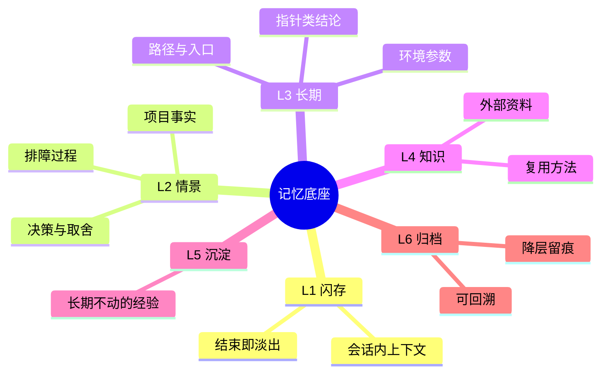
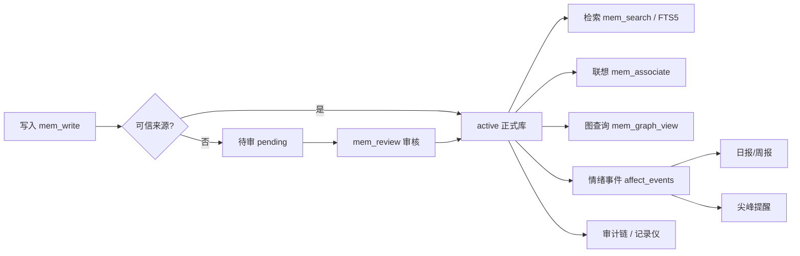

# 记忆导图

> 说明：这是**文档版导图**。工作台「总览」页签里也有一个「记忆导图」卡片，显示层级树。
> 图查询（真实数据里的邻居关系）用 `mem_graph_view` / `mem_graph_traverse`。

## 六层结构



## 横向能力



## 数据之间怎么连

- **标签共现**：共享同一个标签的两条记忆自动连边（`tag`）
- **同批写入**：同一次 `batch_id` 写入的记忆连边（`batch`）
- **图查询**：BFS 1–3 跳，可只保留某类边

```
mem_graph_view({ record_id: "...", hops: 2 })
mem_graph_traverse({ seed_ids: ["...", "..."], hops: 2 })
```

## 当前规模（2026-11-01）

| 层 | 条数 |
|---|---|
| L1 | 9 |
| L2 | 15 |
| L3 | 3 |
| 合计 | 27（S 级 5） |

edges：146 条（标签 145 / 同批 1，实测值取决于当时标签分布）。
